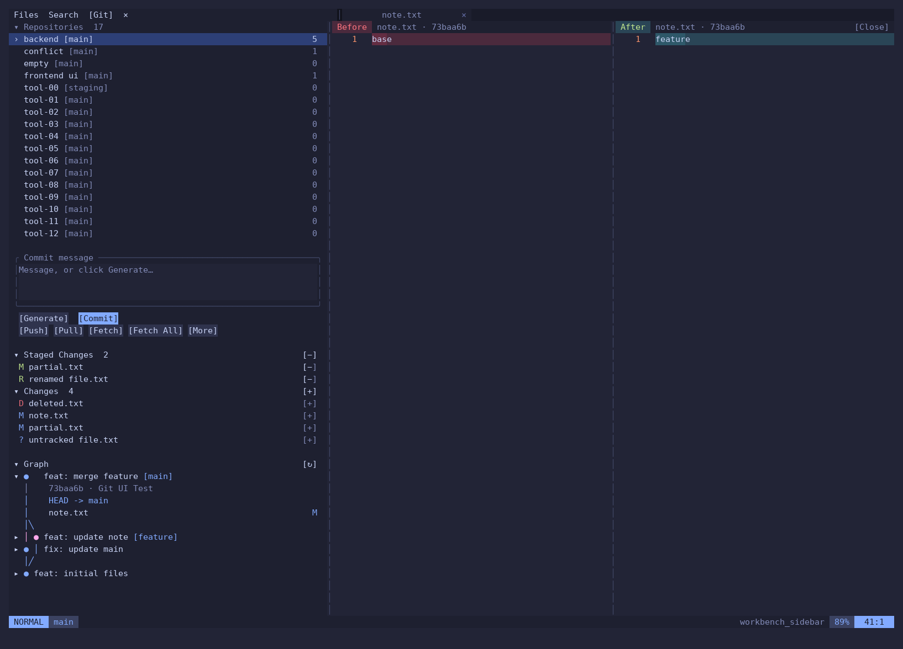
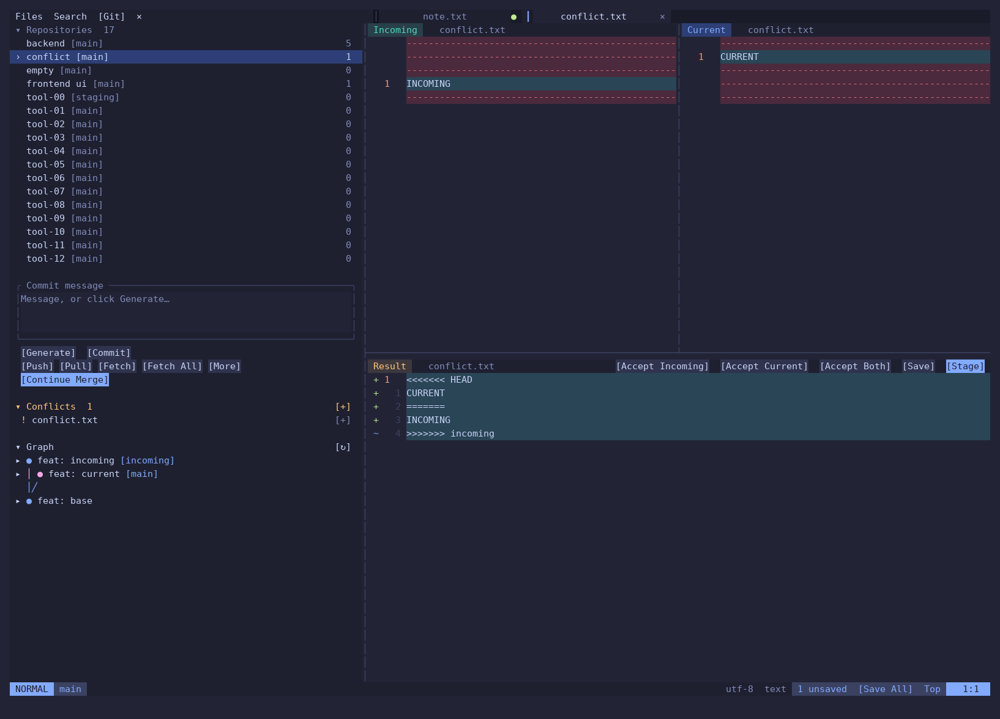

# VimDesk

A Neovim workspace for people who work across several Git repositories and want visible, clickable controls alongside Vim motions.

Open the parent folder. Switch repositories in the Git sidebar. Review changes side by side, resolve conflicts in three resizable panes, and draft a commit with your choice of Codex or Claude Code.

**[Website & install guide](https://ardanngrha.github.io/vimdesk/)** · [English](docs/getting-started.md) · [Bahasa Indonesia](docs/mulai-dari-nol.md)

Install guides: [macOS](https://ardanngrha.github.io/vimdesk/?lang=en&os=macos#install) · [Linux](https://ardanngrha.github.io/vimdesk/?lang=en&os=linux#install) · [Windows via WSL 2](https://ardanngrha.github.io/vimdesk/?lang=en&os=windows#install).



Built by [Ardana Nugraha](https://github.com/ardanngrha) from a daily workflow: an agent edits the code, this workbench handles reviewing, Git, search, and the final commit. Orca is an optional coding companion; the workbench works independently.

## What you get

- **Multiple repositories, one workspace.** Click a repository to select it and show its Changes. Click its branch badge, such as `[staging ↑2 ↓1]`, to switch branches. LazyGit is available under More; `Space gg` opens it for the current file's repository.
- **A visible Git workflow.** Staged/unstaged changes, commit textbox, Generate → Codex / Claude Code, Commit, and `[Push] [Pull] [Fetch] [Fetch All] [More]`. Use `[+]` beside Changes to stage all, or `[−]` beside Staged Changes to unstage all. Controls wrap when the sidebar is narrow.
- **Commit history below Changes.** Graph shows branch lanes and commit subjects. Click a commit to expand its details and files, then click a file to review that revision. Load more history when needed.
- **Review without losing context.** Changed files and historical revisions reuse the same Before / After panes. Conflicts open Incoming on the left, Current on the right, and an editable Result below. Drag native dividers to resize; `Space gc` closes the review.
- **Search in the sidebar.** Search and replace fields, all-repo or active-repo scope, include/exclude filters, ignored-file toggle, and unsaved-buffer search. Preview replacements before applying selected files; saving remains explicit.
- **Daily editing essentials.** TokyoNight Moon, completion, Go / Rust / JS / TS / React / Python LSP configuration, per-repository terminals, outline, Problems, Save All, and workspace sessions.

Files, Search and Git share the sidebar width. Commit/search inputs move with the content and hide when scrolled out of view; ordinary file reviews reuse the same Before / After windows.



## Install

**New to Neovim or starting with a fresh Mac?** Follow the [interactive step-by-step website](https://ardanngrha.github.io/vimdesk/?lang=en#install), [English guide](docs/getting-started.md), or [panduan Bahasa Indonesia](docs/mulai-dari-nol.md). They start with opening Terminal and installing Apple tools, Homebrew, and Neovim, then walk through plugins, a two-repo practice workspace, saving and quitting.

The quick path below is for people who already have Homebrew.

**macOS tested.** [Linux instructions](docs/getting-started-linux.md) cover Ubuntu/Debian with Homebrew. [Windows instructions](docs/getting-started-windows.md) use Ubuntu in WSL 2; native Windows is unsupported. Linux and WSL have not been validated end to end. Requires **Neovim 0.12+**, Git, LazyGit, ripgrep, fd, and Python 3.9+. A compiler and tree-sitter CLI ≥0.26.1 are needed to build syntax parsers. A normal monospace font works; Nerd Fonts are optional.

```sh
git clone https://github.com/ardanngrha/vimdesk.git
cd vimdesk
./scripts/dependencies.sh core       # optional: install missing macOS tools with Homebrew
./install.sh
~/.local/bin/vimdesk /path/to/your/workspace
```

The installer copies the config into `~/.config/vimdesk` and creates `~/.local/bin/vimdesk`. Your default `~/.config/nvim` stays in place. Add `~/.local/bin` to your shell's PATH to launch with just `vimdesk`.

Plugins download on the first launch. Let Lazy finish, restart, then run `:WorkbenchParsers` to install syntax highlighting parsers. Run `:WorkbenchDoctor` for optional missing tools.

```sh
./scripts/dependencies.sh languages # optional LSP tools; JS/TS packages go into workbench data
```

Language runtimes and project dependencies still belong to your projects. AI generation needs an installed, authenticated Codex or Claude Code CLI. No account is bundled, and AI is optional.

[Installation, updates, backups and restore →](docs/installation.md)

## Start with these

`Space` is the leader. Press keys **in sequence**, for example `Space`, `g`, then `Shift+g` for `Space gG`.

| Action | Shortcut / control |
| --- | --- |
| Files / Search / Git | Click the sidebar tabs |
| Quick file search, including ignored files | `Space ff` |
| Search workspace | `Space fg` |
| Git sidebar / repository list | `Space gG` |
| LazyGit for the current file's repository | `Space gg` |
| Find a repository | `Space gP` |
| Fetch all repositories | `Space gF` |
| Diff / staged diff / close review | `Space gd` / `Space gD` / `Space gc` |
| Terminal / outline / Problems | `Space ut` / `Space so` / `Space xx` |
| Save all / unsaved files | `Space wa` / `Space bu` |
| Command palette / shortcut guide | `Space p` / `Space ?` |
| Quit (asks about unsaved changes) | `Space qq` |

Inside LazyGit, use `?` for its own shortcuts. AI generation lives in the **Git sidebar → Generate**; this distribution does not override your global LazyGit configuration or bind Ctrl+G.

[Workflow and editing guide →](docs/workflow.md) · [Architecture →](docs/architecture.md) · [Contributing and verification →](CONTRIBUTING.md)

## Designed for sibling repositories

```text
workspace/
├── backend/       .git/
├── frontend/      .git/
└── tools/         .git/
```

Launch `vimdesk workspace/`. The workspace directory stays stable while LSP roots, Git actions, and terminals use the relevant child repository. Repository discovery also recognizes Git worktrees. Scans skip dependency/build directories and are bounded to six levels and 20,000 directories; open a narrower folder for very large workspaces.

## AI commit drafts

Save your files, stage the intended changes, then click **Generate** and choose an agent. Review or edit the Conventional Commit subject in the textbox, then click **Commit** yourself. Generation never commits or pushes. A changed staged snapshot invalidates the generated draft.

The staged diff (up to 100 KB) is sent to the selected provider through your local CLI and may incur its usual usage costs. Repository rules, tools, hooks and MCP configuration are disabled for the generation subprocess. [Details and limitations →](docs/workflow.md#ai-commit-drafts)

## Scope and credits

This is an opinionated config and custom Lua workbench, not a fork of Neovim, LazyGit or LazyVim. It is a personal project with macOS verification, not a promise of compatibility with every terminal or plugin update. The lockfile pins the plugin revisions used for verification; updating plugins can change behavior.

Built on [Neovim](https://neovim.io), [lazy.nvim](https://github.com/folke/lazy.nvim), [Snacks](https://github.com/folke/snacks.nvim), [TokyoNight](https://github.com/folke/tokyonight.nvim), [LazyGit](https://github.com/jesseduffield/lazygit), [Diffview](https://github.com/sindrets/diffview.nvim), [blink.cmp](https://github.com/saghen/blink.cmp), [nvim-lspconfig](https://github.com/neovim/nvim-lspconfig), [nvim-treesitter](https://github.com/nvim-treesitter/nvim-treesitter), [Gitsigns](https://github.com/lewis6991/gitsigns.nvim), [bufferline](https://github.com/akinsho/bufferline.nvim), [lualine](https://github.com/nvim-lualine/lualine.nvim), [Edgy](https://github.com/folke/edgy.nvim), [Trouble](https://github.com/folke/trouble.nvim), [which-key](https://github.com/folke/which-key.nvim), [persistence](https://github.com/folke/persistence.nvim), and [Plenary](https://github.com/nvim-lua/plenary.nvim). These projects retain their own licenses. This repository's original code is MIT licensed.

Screenshots use disposable fictional repositories; no work projects or credentials are included.
