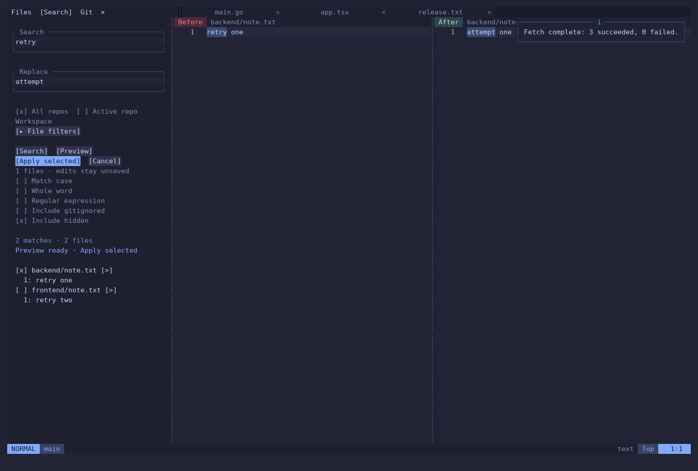

# Using the workbench

## Your first five minutes

Open a folder containing sibling Git repositories. Click Files, Search, or Git at the top of the left sidebar. Drag its right edge to resize it. File tabs are buffers; duplicate filenames get a parent-directory label.

Neovim starts in Normal mode. Press `i` to type and `Esc` to return to Normal mode. Leader shortcuts are sequential: press `Space`, release it, then the remaining keys. A capital `G` means `Shift+g` for that key only.

| Task | Keys in Normal mode |
| --- | --- |
| Save / Save all | `Space w` / `Space wa` |
| Quit with unsaved-change confirmation | `Space qq` or `:qa` then Enter |
| Undo / redo | `u` / `Ctrl+r` |
| Select characters / lines | `v` / `Shift+v`, then move |
| Copy selection / paste | `y` / `p` |
| Copy current line | `yy` |
| Quick file search | `Space ff` (includes hidden and ignored files) |
| Previous / next buffer | `Shift+h` / `Shift+l` |
| Show commands | `Space p` |
| Show shortcuts | `Space ?` |

Clipboard copying uses the system clipboard when your OS has a Neovim clipboard provider. Run `:Tutor` to learn the basic editing motions.

## Git across repositories

`Space gG` opens/focuses the Git sidebar. Click a repository to select it and open its LazyGit session. `Space gP` provides a searchable repo picker; `Space gn` / `Space gp` cycle repositories. Opening a single repository displays its directory name, not `.`.

`Space gg` resolves the current buffer's repository, so it may differ from a previously selected repo. The workspace's parent directory stays unchanged. `:GitRepo` prints the detected root.

1. Review changed files in the Git sidebar. Clicking one opens Before / After.
2. Save your intended file edits. Use the visible Stage All control, or stage individual files/hunks. Stage All includes untracked files except ignored ones; review the list first.
3. Type a subject in the commit textbox, or Generate a draft. Click Commit when ready.
4. Push/Publish sends the selected repository's current branch to its remote. Pull updates the selected repository. Neither action applies to every repo.
5. Fetch All (`Space gF`) fetches each repository's remotes, grouping linked worktrees by shared Git directory. It does not check out, merge, or push branches.

LazyGit remains available for branches, history, rebase, stash and other Git tasks. Its default keys include `Space` to stage a file, `a` to stage/unstage all in the files panel, `P` to push, and `p` to pull. Panel focus matters; use `?` to inspect the bindings of your installed LazyGit version.

For a branch merge, check out the target branch, pull it, select the source branch, and use LazyGit's merge action (`M` in its branches panel). Confirm the branch direction before proceeding. Conflict resolution is described below.

## Review and resolve conflicts

`Space gd` opens the current repo's working changes. `Space gD` reviews staged changes. `Space gc` closes the review. You can also use `:DiffviewOpen`, `:DiffviewOpen --cached`, and `:DiffviewClose`.

Conflicted files open in this layout:

```text
┌───────────────────┬───────────────────┐
│ Incoming (theirs) │ Current (ours)    │
├───────────────────┴───────────────────┤
│ Result — editable                     │
└───────────────────────────────────────┘
```

Drag the vertical and horizontal dividers to resize. Move the cursor to a conflict in Result and use its visible Incoming / Current / Both buttons. Edit Result directly when a combination needs adjustment. Save, review the result, then Stage it. When all conflicts are resolved and staged, the sidebar offers Continue merge.

The labels use Git's ours/theirs semantics. During a rebase, those roles can differ from an ordinary merge; inspect each side's contents before accepting. No button should replace reviewing the result.

## Search and replace

`Space fg` opens Search. Type the search expression and press Enter. Search and Replace are persistent fields; Tab / Shift+Tab moves between fields, Esc leaves field editing.

- Choose All repos or Active repo scope. The active scope uses the selected Git repository.
- Expand Filters for include/exclude patterns separated by `;`.
- Toggle ignored files explicitly for workspace search. Quick file search (`Space ff`) includes ignored files by default.
- Search overlays modified, already-existing file buffers, so unsaved edits are searchable. Save a brand-new file once before expecting it in workspace search.
- Enter a replacement, open its Before / After preview, choose the files to apply, then Apply selected. Applying changes buffers; `Space wa` saves them. Use `u` in an affected file to undo.
- If the source changed while previewing, generate a new preview. Incomplete/truncated search results are not accepted for replacement.



## Terminals, sessions, and code

The bottom panel includes Terminal, Problems, Output, Git Log, Outline and unsaved files. `Space ut` toggles the panel; choose a repository terminal from its tabs/picker. Each terminal keeps a separate working directory and environment for the lifetime of this Neovim process. Restarting Neovim does not preserve running terminal processes.

In a terminal, `Ctrl+\` then `Ctrl+n` returns to Normal mode. A shell may intercept `Ctrl+h/j/k/l`, so use that escape first when needed.

`Space so` requests the current document's LSP outline. Click a symbol to navigate. `gd` goes to definition, `grr` finds references, `K` shows docs, `Space rn` renames a symbol, `Space ca` opens code actions, and `Space cf` formats explicitly. These features require an attached language server.

`Space qs` saves the workspace session and `Space qr` restores it. Sessions remember editing layout/files, not shell processes. Save All (`Space wa`) handles unsaved file buffers; `Space bu` lists them first.

## AI commit drafts

Save the intended edits, stage them, then click Generate in Git. Choose Codex or Claude Code. The result fills the commit textbox for review; it never commits or pushes automatically.

The generator reads the staged patch and stat only, caps the patch at 100 KB, and asks for one English Conventional Commit subject of at most 72 characters. It rejects invalid output, unresolved conflicts, and staged changes made during generation. A user-edited draft is preserved if an earlier generation completes late.

The chosen CLI receives the staged diff through stdin in a temporary working directory. The subprocess disables repository instructions, tools, hooks, and MCP configuration using that CLI's supported flags. The provider still receives the diff and uses your account; stage only content you are comfortable sending. Normal provider usage limits and costs apply.

CLI invocation flags were checked with Codex 0.163.0 and Claude Code 2.1.302. If a newer CLI rejects them, write the subject manually and check Output. The generator only reads Git state and prints a draft. For terminal use:

```sh
python3 "$HOME/.config/vimdesk/scripts/ai_commit.py" --agent codex
```

There is no default AI binding inside standalone LazyGit. This avoids overriding existing custom commands; the persistent sidebar supplies the agent picker, textbox, and review step.
